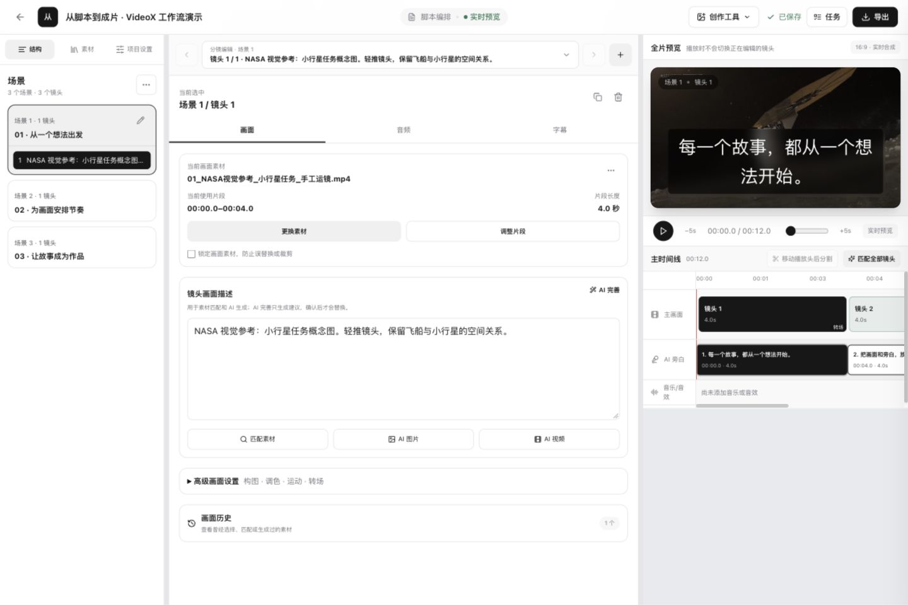
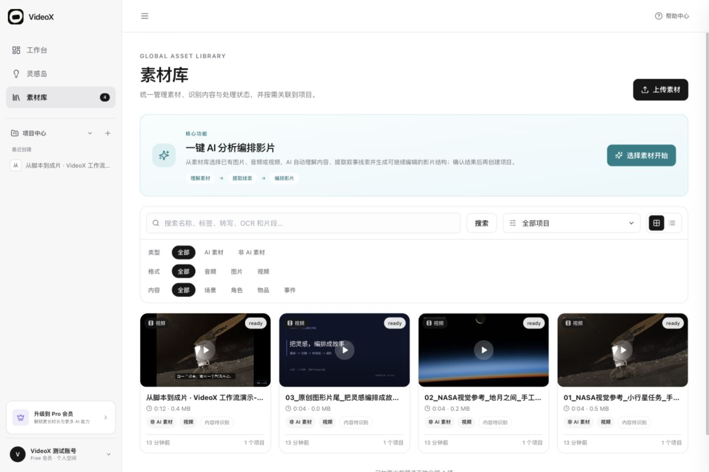
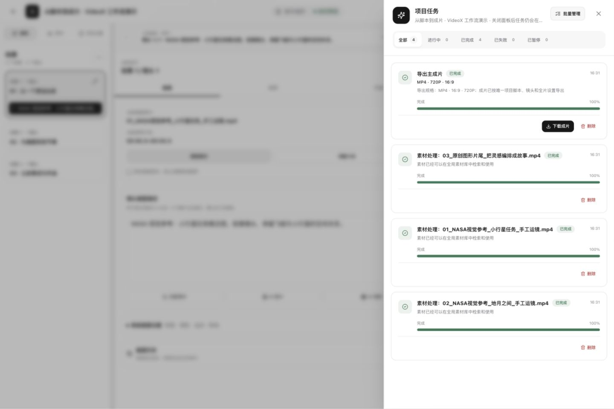

<p align="center">
  <picture>
    <source media="(prefers-color-scheme: dark)" srcset="frontend/public/branding/videox-mark-minimal-light.svg">
    
  </picture>
</p>
<h1 align="center">VideoX</h1>
<p align="center"><strong>脚本驱动的 AI 视频创作工作台</strong><br>把创作意图写成脚本，让场景、镜头、素材与成片围绕同一份项目数据协作。</p>
<p align="center">
  <a href="README.en.md">English</a> ·
  <a href="#快速开始">快速开始</a> ·
  <a href="docs/architecture.md">架构</a> ·
  <a href="docs/configuration.md">配置</a> ·
  <a href="docs/github-pages.md">展示站</a>
</p>
<p align="center">
  <a href="LICENSE"></a>
  <a href=".github/workflows/check.yml"></a>
</p>



真实本地工作区：3 个场景、3 个镜头、12 秒，手工编写脚本并完成离线导出。画面使用 NASA 视觉参考和原创标题卡，未调用 AI，素材署名见[第三方说明](THIRD_PARTY_NOTICES.md)。

## 脚本即创作规格 · Script as Spec

借鉴**规格驱动开发（Spec-Driven Development）**：先把创作目标落实为可编辑的场景、镜头、台词/旁白、画面与时长要求，再以这份创作规格组织检索、生成、配音与渲染。这里的脚本指视频创作脚本。


创作者可以持续修改脚本、选择素材和调整声音；模型提供草稿、候选或生成媒体，后端负责版本校验、任务调度和确定性媒体处理。**人工编辑与导出可以独立于 AI 运行。**

## 从脚本到成片

- **写脚本**：手动编写、导入脚本表格，或接入文本模型生成可编辑的场景与镜头。
- **补画面**：上传自己的媒体；按需启用语义检索、重排序、生图、文生视频或图生视频。
- **调成片**：选择镜头媒体版本，调整旁白、字幕、声音和项目主时间线；AI 配音单独启用。
- **导出视频**：把已选媒体编排为主成片，通过后台 FFmpeg 任务导出 MP4，查看真实处理状态。

<details>
<summary><strong>查看更多真实界面：素材管理与导出结果</strong></summary>

### 素材管理



上传的短视频经过真实媒体处理；截图中的参考画面由 NASA 图片制作，不是 AI 生成结果。

### 成片与任务



同一项目中的脚本、选中媒体与主成片关联，导出状态来自实际后台任务。

</details>

## 工程设计

| 设计 | 解决的问题 | 源码入口 |
| --- | --- | --- |
| **统一项目文档与修订保护** | 保存校验 `expected_revision`；异步结果再次检查版本，过期生成结果保留为媒体历史，保护后续编辑 | [工作区](backend/app/services/workspace.py) · [结果写回](backend/app/tasks/generate_tasks.py) |
| **有来源约束的灵感工作流** | 查询规划、重新抓取、引用白名单、JSON 校验与一次修复；链接监测先计算 Diff，再总结变化 | [灵感任务](backend/app/tasks/inspiration_tasks.py) |
| **持久化生成任务** | 排队容量与供应商在途并发分开限制；延迟轮询与媒体回收；提交结果未知时不盲目重提，避免重复付费 | [队列](backend/app/services/video_queue.py) · [状态机](backend/app/tasks/video_tasks.py) |
| **确定性成片执行** | 项目数据编译为渲染计划，FFmpeg 完成并持久化结果后才确认导出成功；编排阶段不隐式调用模型 | [渲染计划](backend/app/services/composition_render_plan.py) · [导出](backend/app/tasks/export_tasks.py) |

技术栈：**React 19 / TypeScript / FastAPI / Celery / PostgreSQL + pgvector / Redis / MinIO / FFmpeg**。脚本与镜头的数据结构见[模型](backend/app/models/script.py)，完整数据流与失败边界见[架构说明](docs/architecture.md)。

## 快速开始

需要 Docker Engine/Desktop 和 Compose v2。在受控本地环境运行：

```bash
git clone https://github.com/WowCoder/VideoX.git
cd VideoX
cp .env.example .env
docker compose config --quiet
docker compose up -d --build
```

打开 [localhost:5273](http://localhost:5273)，使用邮箱注册。首次建议：**上传自己的短视频 → 建立场景和镜头 → 选择素材 → 编排主成片 → 导出 MP4**。API 文档位于 [localhost:8000/docs](http://localhost:8000/docs)。

示例关闭所有 AI Provider，不会下载模型或调用付费 AI；已有 `.env` 时保留原文件，并在启动前检查配置。主成片编排不会自动为缺失镜头发起付费生成。完整步骤见[快速开始](docs/getting-started.md)，按需接入模型见[配置说明](docs/configuration.md)。

已有部署升级须显式衔接既有数据卷、数据库、bucket 和队列，新默认名称不会自动迁移资源，见[切换说明](docs/configuration.md#既有部署切换)。根目录 Compose 用于本地开发；生产环境使用[部署手册](deploy/README.md)。

## 文档与参与

| 开始使用 | 了解实现 | 运行与部署 |
| --- | --- | --- |
| [快速开始](docs/getting-started.md) | [架构与 AI 工作流](docs/architecture.md) | [配置与 Provider](docs/configuration.md) |
| [当前能力与边界](docs/limitations.md) | [开发与检查](docs/development.md) | [生产部署](deploy/README.md) · [Pages 展示站](docs/github-pages.md) |

当前不提供多人实时协作；AI 能力需要相应 Provider、账号权限及费用。素材匹配保留候选供选择；生成媒体在镜头未继续编辑时可能成为选中版本。更多行为与验证范围见[当前边界](docs/limitations.md)和[开源准备记录](docs/open-source-readiness.md)。

欢迎提交可复现的问题和有验证结果的改进：[贡献指南](CONTRIBUTING.md) · [安全报告](SECURITY.md)。

代码采用 [MIT](LICENSE)；模型、第三方素材与外部服务遵循各自条款，详见[第三方说明](THIRD_PARTY_NOTICES.md)。
