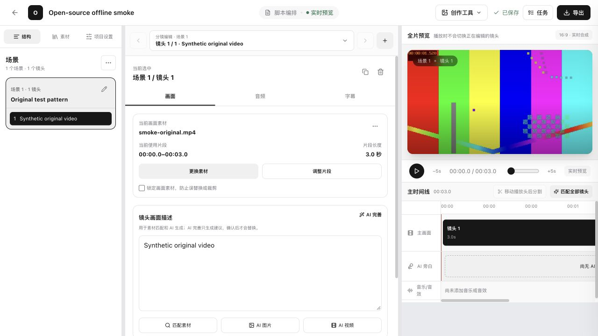

# OpenVMA

[English](README.en.md) · [快速开始](docs/getting-started.md) · [架构](docs/architecture.md) · [配置](docs/configuration.md)

OpenVMA 是面向桌面浏览器的视频创作工作台：管理真实素材，编写脚本与分镜，检索可用镜头，编辑项目主时间线，再通过 FFmpeg 导出成片。

AI 能力是可选组件。项目把模型输出、用户选择和确定性媒体处理分开：模型负责搜索规划、结构化草稿、语义候选与媒体生成；用户决定使用哪些镜头；后端负责版本校验、任务调度、主成片编排和导出。

仓库包含 React/TypeScript 前端、FastAPI 后端、Celery Worker/Beat，以及 PostgreSQL/pgvector、Redis、MinIO 和可选本地模型服务。代码采用 [MIT](LICENSE)；模型、外部服务及第三方素材的许可另见 [THIRD_PARTY_NOTICES.md](THIRD_PARTY_NOTICES.md)。



实际工作区截图：3 秒原创测试视频、手动分镜和离线导出，未调用 AI 服务。验证范围见 [开源准备记录](docs/open-source-readiness.md)。

## 能做什么

| 能力 | 当前实现 | 前提 |
| --- | --- | --- |
| 邮箱账号与项目 | 邮箱注册/登录、个人项目、项目素材关联 | 基础服务 |
| 素材管理 | 视频/音频上传，FFprobe 校验，缩略图、镜头切分、试听代理 | FFmpeg、MinIO |
| 人工创作 | 场景、镜头、台词、素材选择、声音、字幕与主时间线 | 基础服务 |
| 语义匹配 | 向量召回、可选重排序、逐镜头候选及匹配理由 | Embedding；Reranker 可选 |
| 脚本与视觉分析 | 结构化脚本、镜头描述补全、人物/物品/场景识别 | 显式启用文本/视觉 Provider |
| 灵感任务 | 联网选题发现、来源更新监测、引用和变化证据 | 搜索；生成结果还需文本模型 |
| 分镜媒体生成 | 生图、文生视频、图生视频、草图动效、素材版本历史 | 对应 Provider、账号权限和费用 |
| AI 配音 | 分段合成、归一化、时长适配与音频回收 | 单独启用 DashScope TTS |
| 主成片与导出 | 唯一项目主成片编排，多轨音频、字幕、FFmpeg 导出 | 已选素材；基础服务 |
| 任务与运营后台 | 持久化任务、状态查询、独立管理员账号和 TOTP | Worker/Beat；后台单独启动 |

会员、账单、支付适配器与发票申请属于仓库中的业务模块；正式收款和税务服务需要部署者配置外部服务。当前不提供多人实时协作。详见 [当前边界](docs/limitations.md)。

## 从素材到成片

```text
上传自己的素材 → FFmpeg 处理 → 建立项目和分镜
                                      │
                  可选：语义匹配 → 候选 → 用户选择
                  可选：生图/视频 → 素材版本
                                      │
                       主成片编排 → 编辑 → FFmpeg 导出
```

素材匹配不会自动替你采用第一个候选，也不会自动对缺失镜头发起付费生成。生成媒体可能在镜头未继续编辑时成为当前选中版本；镜头已经变化时，结果保留在版本历史中供用户复核。

主成片编排消费项目已有的场景、镜头、选中媒体与声音设置。未补齐镜头会保留缺失状态；编排成功也不等于导出已完成。

## 快速启动：先跑通人工媒体流程

需要 Docker Engine/Desktop 和 Compose v2。Docker 路径不要求宿主机安装 Node、Python 或 FFmpeg；宿主机开发和 Pages 构建使用 Node 22、Python 3.12。

```bash
git clone https://github.com/WowCoder/OpenVMA.git
cd OpenVMA
cp .env.example .env
```

新复制的示例关闭全部 `AI_*_PROVIDER`，首次运行不会下载模型或调用付费 AI。若已有 `.env`，启动前明确检查所有 AI Provider 为 `disabled`；复制操作不要覆盖你已有的配置。

```bash
docker compose config --quiet
docker compose up -d --build
docker compose ps
```

| 服务 | 本地地址 |
| --- | --- |
| 用户前端 | [localhost:5273](http://localhost:5273) |
| API 文档 | [localhost:8000/docs](http://localhost:8000/docs) |
| MinIO Console | [localhost:9001](http://localhost:9001) |

打开用户前端，使用邮箱注册，无需短信或微信凭证。创建空白项目，上传一个自己拥有使用权的小型视频，建立场景和镜头，选择素材，编排主成片并导出 MP4。建议先测试数秒媒体，再增加素材规模。

AI 全部关闭时，FFmpeg 元数据、镜头切分、缩略图、人工编辑和导出仍可使用；ASR、OCR、视觉分析、语义匹配和 AI 生成不可用。页面不会为缺失能力填充模型结果。

检查应用和任务：

```bash
docker compose logs -f backend celery-worker celery-beat
curl --fail --show-error http://localhost:8000/api/health
```

完整步骤、故障排查和非 Docker 启动见 [快速开始](docs/getting-started.md)。根目录开发 Compose 包含源码挂载、开发凭证和服务端口，应在受控本地环境使用。生产部署从 [deploy/README.md](deploy/README.md) 开始。

## 按需启用 AI

启用本地模型前，先编辑根目录 `.env`：

```dotenv
AI_EMBEDDING_PROVIDER=local
AI_RERANK_PROVIDER=local
AI_ASR_PROVIDER=local
AI_OCR_PROVIDER=local
LOCAL_AI_API_KEY=replace-with-a-random-token-at-least-24-characters
```

然后启动并重新创建应用服务，使新环境变量生效：

```bash
docker compose --profile local-ai up -d --build
docker compose logs -f local-embedding local-reranker local-asr local-ocr
```

模型首次启动会下载权重并占用内存/磁盘。CPU 可运行，具体速度取决于硬件、输入和并发；仓库没有公布速度或质量基准。模型数据保存在 Docker Volume。

| 可选本地服务 | 用途 |
| --- | --- |
| BGE-M3 | 1024 维 Embedding |
| BGE Reranker | 候选重排序 |
| FunASR | 语音识别 |
| RapidOCR / PP-OCR ONNX | 抽帧文字识别 |

云端文本、视觉、生图、文生视频和图生视频支持 DashScope 或 Agnes；草图动效与 TTS 当前仅支持 DashScope。TTS 有独立开关。Provider 不会从本地失败静默回退到线上付费服务。

云端能力必须同时配置对应 Provider、密钥和已开通模型；密钥本身不会启用示例中关闭的能力。模型可用性、额度、地域、费用和输出限制以你的服务账号为准，配置矩阵见 [配置说明](docs/configuration.md)。

## 工程实现

```text
React / Vite ── REST + WebSocket ── FastAPI
                                    ├── PostgreSQL / pgvector
                                    ├── MinIO（媒体与导出文件）
                                    └── Redis / Celery / Beat
                                          ├── FFmpeg / FFprobe
                                          ├── 可选本地 AI
                                          └── 显式配置的云端 Provider
```

可从以下源码入口检查实际行为：

- [灵感任务](backend/app/tasks/inspiration_tasks.py)：搜索查询规划、抓取候选、真实来源引用白名单、JSON 校验与一次修复重试；链接监测先做确定性 Diff，再总结变化。
- [素材匹配](backend/app/tasks/match_tasks.py)：匹配当前 Embedding 模型的素材向量，逐镜头写入候选，写入前检查项目版本。
- [项目工作区](backend/app/services/workspace.py)：`expected_revision` 乐观并发控制、素材选择和项目修订记录。
- [视频队列](backend/app/services/video_queue.py)与[视频任务](backend/app/tasks/video_tasks.py)：排队容量和供应商在途并发分别限制，持久化提交、轮询和媒体回收。
- [主成片任务](backend/app/tasks/roughcut_tasks.py)、[渲染计划](backend/app/services/composition_render_plan.py)与[导出](backend/app/tasks/export_tasks.py)：把已选项目数据编译为可执行媒体计划。

视频等待供应商生成时使用延迟轮询，不长期占用 Worker 执行槽。供应商提交结果无法确认时不会盲目自动重提；已知供应商任务的查询或媒体回收失败可进入可恢复状态。更完整的状态与失败边界见 [架构说明](docs/architecture.md)。

## 开发与检查

```bash
make help
make check
```

`make check` 使用已运行的开发容器，执行 Compose 校验、后端测试/编译、前端测试、lint 和应用构建。独立管理端与 Pages 构建见 [开发指南](docs/development.md)。

前端 Vite 代理使用服务端环境变量 `API_PROXY_TARGET`：宿主机开发默认访问 `http://localhost:8000`，Compose 前端访问 `http://backend:8000`。它不作为浏览器构建配置注入静态页面。

管理端不会随着用户前端在 5273 端口启动。在独立终端中：

```bash
cd frontend
npm ci
npm run dev:admin
```

访问 [localhost:5274/admin.html](http://localhost:5274/admin.html)。管理员需通过 `backend/scripts/manage_admin.py` 单独创建并配置 TOTP；普通邮箱用户不是管理员。

## GitHub Pages 展示站

展示站使用独立入口，不连接应用 API，也不要求登录。仓库提供源码、配置和发布工作流；以下地址是部署后预期地址，不表示已上线：

`https://WowCoder.github.io/OpenVMA/`

```bash
cd frontend
npm ci
npm run build:pages
```

产物位于 `frontend/dist-pages/`，默认 base 为 `/OpenVMA/`。启用 GitHub Actions、Settings → Pages 与仓库 About Website 的操作见 [Pages 指南](docs/github-pages.md)。

## 文档与贡献

- [快速开始](docs/getting-started.md)：邮箱注册、人工媒体流程、宿主机启动和后台。
- [架构说明](docs/architecture.md)：数据模型、AI 边界、任务恢复和确定性渲染。
- [配置说明](docs/configuration.md)：Provider、队列、存储、身份与生产配置。
- [开发指南](docs/development.md)：目录、检查、迁移与向量重建。
- [当前边界](docs/limitations.md)：未提供能力、外部依赖和验收范围。
- [生产部署](deploy/README.md)、[发布](deploy/release.md)、[恢复](deploy/restore.md)。

欢迎提交可复现的问题和有验证结果的改进。参与方式见 [CONTRIBUTING.md](CONTRIBUTING.md)；安全问题处理见 [SECURITY.md](SECURITY.md)。
