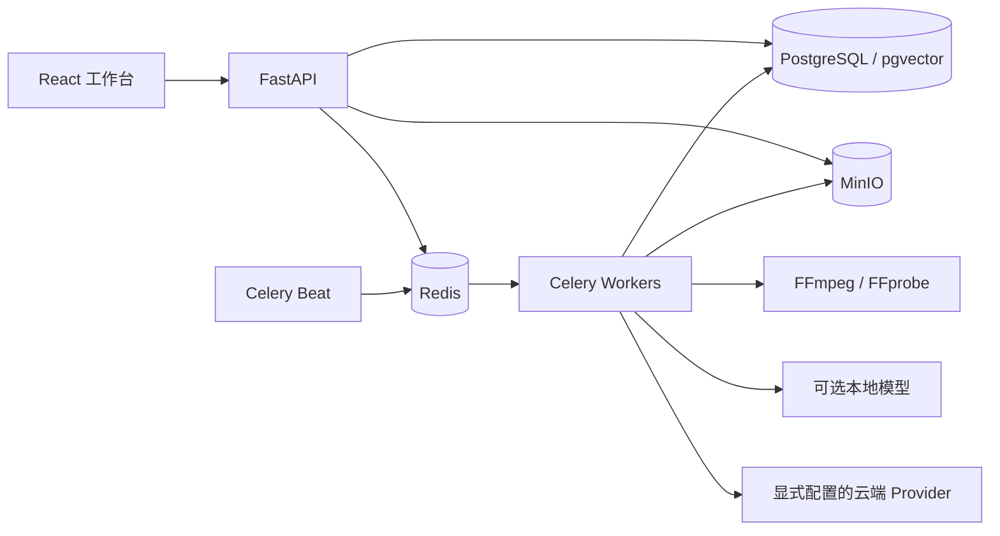

# 架构与 AI 工作流

[返回 README](../README.md) · [配置](configuration.md) · [边界](limitations.md)

OpenVMA 的应用状态以 PostgreSQL 为准；Redis 负责消息、缓存和调度，MinIO 保存原始媒体、预览与生成/导出文件。FastAPI 提供鉴权 API，Celery 执行媒体和 AI 任务，Beat 派发周期工作。前端通过 REST 和 WebSocket 读取真实状态，轮询提供任务状态兜底。



## 项目是同一个可编辑聚合

一个项目拥有脚本、场景、镜头、关联素材及主成片配置。项目工作区返回一个统一文档，脚本/分镜与主时间线来自这份项目数据。镜头可引用素材区间或选中媒体版本；历史版本记录来源和生成参数。

保存请求带 `expected_revision`。服务端锁定项目聚合并比较当前版本，旧客户端提交会得到冲突；删除、恢复与异步结果也记录修订。项目修订记录用于审计和恢复，当前主成片工作流不会复制成另一个隐藏脚本或独立初剪项目。

源码：[工作区聚合](../backend/app/services/workspace.py)、[项目 API](../backend/app/api/projects.py)、[项目 Schema](../backend/app/schemas/project.py)。

## 素材处理与候选匹配

上传校验包括大小、文件签名和 FFprobe；Worker 提取元数据、生成预览/缩略图、切分镜头，再按配置执行 ASR、OCR、视觉分析和向量索引。独立音频生成标准化试听文件。AI 阶段不可用时保留可用的确定性媒体结果和真实降级信息。

匹配以镜头为单位：场景台词/画面意图与镜头描述形成查询，Embedding 生成向量，pgvector 召回相同模型来源的真实片段，可选 Reranker 重新排序。候选包含素材区间和匹配理由，任务在写入前再次比较项目基线版本。

匹配结果是候选列表。用户明确选择后才成为当前镜头素材，主成片编排不会执行隐式检索或缺失镜头生成。数据库向量为 1024 维，但维度相同不代表模型空间兼容；索引保存模型来源、状态和内容 hash。

源码：[媒体任务](../backend/app/tasks/media_tasks.py)、[匹配任务](../backend/app/tasks/match_tasks.py)、[Provider](../backend/app/services/ai_provider.py)。

## 灵感任务：规划、证据与结构校验

选题发现先请求文本模型规划少量互补搜索查询；规划失败时使用固定规则构造查询。搜索返回候选后，系统重新抓取并清洗来源，检查可用正文，并依据搜索结果提供的时间信息过滤过期候选，按来源策略与字符预算构造证据输入。

生成输出需要合法单个 JSON 对象，且每个选题必须引用至少一个已验证候选。引用 URL 白名单来自本次证据，模型编造的 URL 不会写入结果；数量或结构不合法时携带校验错误重试一次，仍失败则任务失败。结果保存使用的查询、候选数量、引用、模型来源与搜索警告。

链接监测使用条件请求、来源状态与结构化指纹，区分首次基线、无变化、内容变化、结构变化与抓取失败。确定性 Diff 产生变化证据后才调用模型总结；首次抓取和页面结构变化不会伪装成新增新闻。部分来源失败会留下 `PARTIAL` 结果及错误信息。

来源正文作为不可信数据传入 Prompt；引用校验能限制 URL 来源，不能证明模型每句话都正确。需要发布的选题仍应由创作者核对原文。

源码：[任务](../backend/app/tasks/inspiration_tasks.py)、[来源抽取与 Diff](../backend/app/services/inspiration_extraction.py)、[联网搜索](../backend/app/services/web_search.py)、[调度](../backend/app/services/inspiration_schedule.py)。

## 视频任务：短提交、延迟查询与持久化

批量生成有一个批次和逐镜头 Job。排队容量与用户/项目/全局供应商在途并发分别限制；调度器分配执行机会后，提交任务先保存 `SUBMITTING`，再调用供应商并记录 task id、Provider、model 和运行参数。

```text
QUEUED → DISPATCHING → SUBMITTING → PROVIDER_RUNNING
                                           │ 延迟查询
                                           ▼
                                      PERSISTING → SUCCEEDED
```

每次轮询是独立任务，等待远端视频生成不会持续占用 Worker 执行槽。成功结果要经过下载地址限制、媒体回收与 MinIO 持久化，再写入 Asset、镜头媒体版本和成功状态；只取得远端 URL 不等于完成。

提交网络异常可能发生在供应商已收单、但 task id 尚未可靠保存的窗口。系统不会对未知提交结果盲目自动重提，避免重复付费；错误保留 `PROVIDER_SUBMIT_OUTCOME_UNKNOWN`，中断状态由调度恢复逻辑处理。已有 task id 的查询异常和回收失败可以进入暂停/恢复路径，继续使用原任务而非重新付费生成。恢复并不保证供应商仍保存结果。

生成结束时重新检查镜头 revision：未编辑过的镜头可以采用新版本；镜头已变化时存入历史并标记旧结果，保留用户的新选择。并发镜头写回会锁定项目并递增统一修订号。

源码：[队列与背压](../backend/app/services/video_queue.py)、[任务状态机](../backend/app/tasks/video_tasks.py)、[结果回收与版本保护](../backend/app/tasks/generate_tasks.py)、[恢复命令](../backend/app/services/job_commands.py)。

## Provider 与配音

文本、视觉、生图和普通视频适配 DashScope/Agnes；基础模型适配本地服务或指定 DashScope 能力。草图动效视频和 TTS 当前为 DashScope。每项 Provider 独立启用，不做本地到付费云端的静默回退。

配音从场景/台词和声音设置生成计划，分段请求 TTS，下载后使用 FFmpeg 归一化与拼接，处理时长适配并持久化音频和任务结果。TTS 单独开关；配置图片/视频密钥不会自动授权配音。

源码：[Provider](../backend/app/services/ai_provider.py)、[TTS 服务](../backend/app/services/tts/)、[配音任务](../backend/app/tasks/voice_tasks.py)。

## 确定性主成片与导出

主成片编排检查项目 revision，读取已选镜头，计算时长、字幕来源和缺失状态，并记录 composition 修订。它不会在编排阶段请求模型。

渲染计划把镜头顺序、媒体区间、画幅、字幕、视觉层、转场与音轨设置编译为导出数据。FFmpeg 负责编码、滤镜和混音，真实命令完成后才保存导出结果。前端主工作区提供 MP4 导出；后端包含其他格式处理，但不等于所有格式都有相同 UI 入口。

源码：[主成片任务](../backend/app/tasks/roughcut_tasks.py)、[渲染计划编译](../backend/app/services/composition_render_plan.py)、[FFmpeg 导出](../backend/app/tasks/export_tasks.py)。

## 执行与权限边界

开发 Compose 的一个 Worker 监听全部开发队列；生产配置将 control、short-ai、video、media、export 工作分离。管理员拥有独立入口、JWT 和 TOTP；用户网关隐藏管理路径，后台网关只代理管理 API。

Pages 展示站是独立静态入口，不加载应用路由、用户会话或 API 客户端；不能代替部署后的创作应用。详见 [Pages](github-pages.md) 与 [生产部署](../deploy/README.md)。
